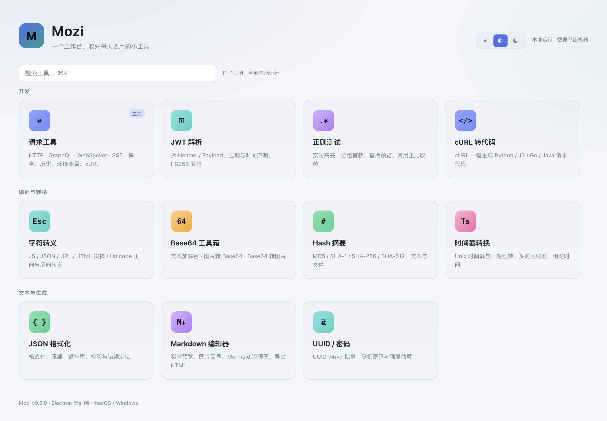
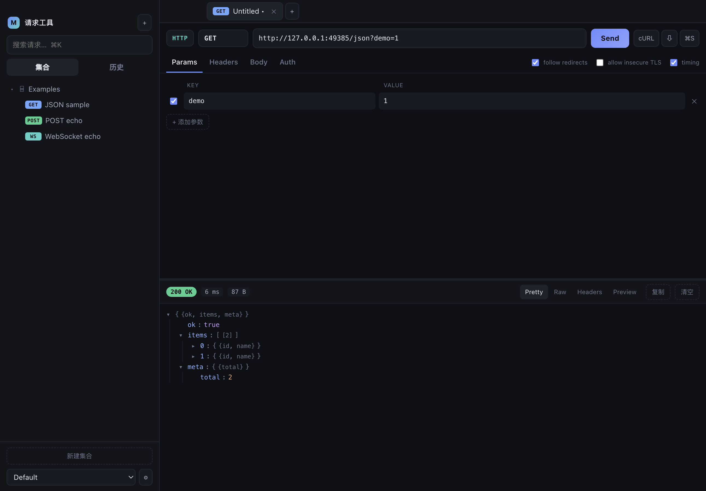
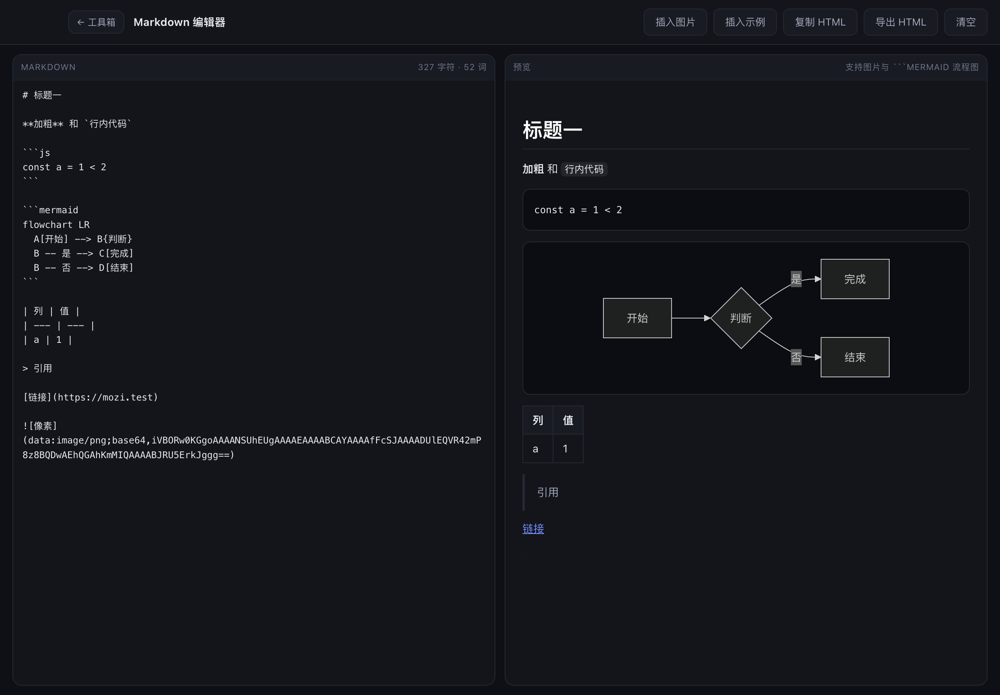
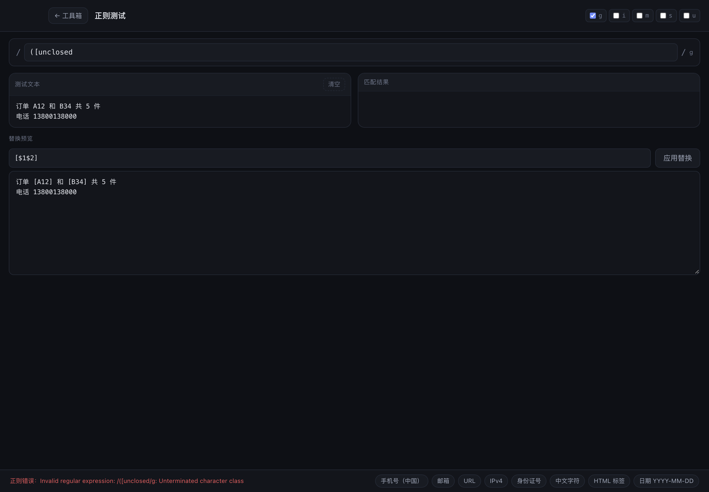
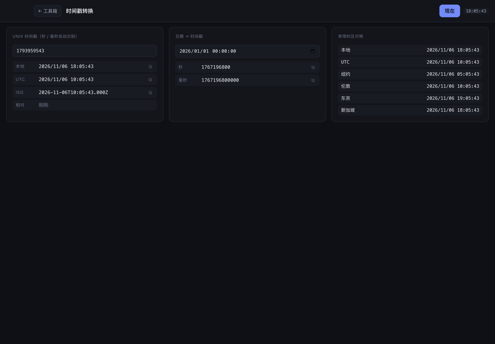

# Mozi

本地优先的桌面工具箱：API 调试、字符转义、JSON 格式化、Base64、图片 Base64、Markdown 预览，全在一个窗口里。



## 工具一览

首页按 **开发 / 编码与转换 / 文本与生成** 三组排列，支持搜索过滤（`⌘K` 聚焦）。

### 开发

| 工具 | 能力 |
|---|---|
| **请求工具** | HTTP 全方法、GraphQL、表单/文件上传、WebSocket、SSE（任意方法，含 POST body）；集合与历史、环境变量、**Cookie 管理**、cURL 导入导出、认证助手、响应树 |
| **JWT 解析** | 拆 Header / Payload（UTF-8 安全）、`exp`/`nbf`/`iat` 时间状态与倒计时、HS256 验签（常数时间比较） |
| **正则测试** | 实时匹配计数、分组与命名捕获、替换预览、正则错误提示、8 个常用正则收藏、g/im/s/u 开关 |
| **cURL 转代码** | cURL 一键生成 Python(requests) / JS(fetch) / Node(axios) / Go(net/http) / Java(OkHttp) 代码，可直接用请求工具当前请求或粘贴 cURL |

### 编码与转换

| 工具 | 能力 |
|---|---|
| **字符转义** | JavaScript 字符串、JSON 字符串、URL、HTML 实体、Unicode `\uXXXX`，每个方向都支持转义与去转义 |
| **Base64 工具箱** | 一页三个标签：文本加解密（UTF-8 / URL-safe）、图片 → Base64、Base64 → 图片（预览、尺寸、体积、存图） |
| **Hash 摘要** | MD5 / SHA-1 / SHA-256 / SHA-512，文本（UTF-8/Hex/Base64 输入）与文件流式计算，一键复制 |
| **时间戳转换** | Unix 秒/毫秒自动识别 ↔ 日期、本地/UTC/多时区对照、实时时钟、相对时间（3 分钟前） |

### 文本与生成

| 工具 | 能力 |
|---|---|
| **JSON 格式化** | 2/4 空格格式化、压缩、键名排序、语法校验（错误带行列）、键/节点统计 |
| **Markdown 编辑器** | 左右分栏实时预览；图片回显（本地/粘贴/拖入）、```mermaid 流程图```、表格、代码块，可导出 HTML |
| **UUID / 密码** | UUID v4 与 v7（时间有序）、批量、大写/花括号；随机密码（字符集与长度可调、排除易混淆字符）与熵估算 |









## Cookie 管理

请求工具新增 **Cookies** 标签页：

- 响应里的 `Set-Cookie` 自动存入 Cookie Jar（Domain / Path / Secure / HttpOnly / Expires / Max-Age 全解析）
- 下一次请求按**域名后缀 + 路径边界**自动匹配附加；手动写了 `Cookie` 头则不覆盖
- 每条可勾选启用 / 停用、改名改值、删除；支持手动添加与一键清空
- Jar 随 data.json 持久化，启动时自动清理过期项

## 保存语义

- 点 **「保存」**（或 `⌘S`）才会把请求写入集合并命名——编辑过程中不会自动改集合
- 当前所有标签页、集合、历史、Cookie、环境等**工作状态**始终自动持久化到本地文件，重启后原样恢复

## 主题

首页右上角切换 **浅色 / 跟随系统 / 深色**（默认跟随系统），选择会持久化，
窗口底色、Mermaid 流程图配色同步切换。

## 打开本地 Markdown

Markdown 编辑器工具栏的「打开 .md 文件…」直接加载本机文件（md / markdown / txt）。

## 布局可拖拽

所有分栏都能用鼠标拖动调整，双击分隔条恢复默认，尺寸按分栏记忆（重启后保持）：

- **左右**：侧栏宽度；转义 / JSON / Base64（文本与两个图片面板）/ JWT / Hash / 密码 / 正则 / cURL 转代码 / Markdown 的双栏
- 工具箱首页：头部与搜索固定，只有工具列表滚动
- **上下**：请求工具里请求区与响应区的高度
- 分隔条获得焦点后可用方向键微调，`Home` / `End` 到边界

## 设计取向

- **本地优先**：所有数据只写入本机 `userData/data.json`，不发任何统计请求
- **零框架**：渲染层是原生 HTML/CSS/JS，没有 React/Vite/打包步骤；运行时依赖只有 `ws`
- **一个窗口**：工具箱首页 → 工具页，返回即回首页，工具状态各自保留

## 导航

- 首页搜索框可按名称/描述/拼音关键词过滤工具
- 任意工具页左上角 **`← 工具箱`** 返回工具选择页
- 快捷键 **`Esc`** 返回工具箱（有弹窗时先关闭弹窗）
- **`⌘/Ctrl + 1`** 回工具箱，**`⌘/Ctrl + 2…9`** 直达各工具（菜单 **Go**）
- **`⌘/Ctrl + E`** 回工具箱并聚焦搜索框
- 请求工具里点侧栏左上角的 **M** 也能返回

## 快捷键（请求工具内）

| 快捷键 | 动作 |
|---|---|
| `⌘/Ctrl + Enter` | 发送请求 / 连接流 |
| `⌘/Ctrl + N` | 新建请求标签页 |
| `⌘/Ctrl + S` | 保存到集合 |
| `⌘/Ctrl + I` | 导入 cURL |
| `⌘/Ctrl + K` | 聚焦搜索框 |
| `⌘/Ctrl + W` | 关闭当前标签页 |

## 开发

```bash
npm install
npm start      # 启动
npm test       # 单元测试：HTTP / WS / SSE / cURL / codec / jwt / codegen / markdown
npm run smoke  # 端到端：起本地服务，走完 6 个工具的 50 项断言并截图
```

`npm run smoke` 覆盖 **142 项断言**：首页分组与 11 个工具卡片、HTTP 请求与 JSON 树、WS 收发、
SSE 流（GET 与 POST body）、集合保存落盘、cURL 导入导出、转义 / JSON / Base64（文本 + 图片三标签）/
Markdown（含 Mermaid 与图片）、时间戳、Hash（含已知向量校验）、UUID/密码、正则、JWT、代码生成，
以及返回工具箱（所有工具统一为 M 图标）、首页搜索、最近使用、⌘1…⌘9 直达、
分栏拖拽 / 双击重置 / 重启后恢复、主题切换、Markdown 打开本地文件、
Cookie 自动收集与回发（grant → jar → whoami 往返）。

```bash
npm run smoke -- --no-sandbox --disable-gpu   # 沙箱 / CI 环境
```

## 打包

```bash
npm run dist:mac   # macOS dmg + zip
npm run dist:win   # Windows NSIS + 便携版
```

产物在 `release/`：

- macOS：`Mozi-<version>-arm64-mac.zip`（解压即用）+ `mac-arm64/Mozi.app`
- Windows：NSIS 安装包 + 便携版 `.exe`

**DMG 说明**：`hdiutil` 需要挂载磁盘，在受限/沙箱环境会失败（`操作不被允许`）。
普通 macOS 或 CI 上 `npm run dist:mac` 会自动产出 dmg；受限环境用 zip 分发。

**Windows 说明**：`electron-builder` 不能从 macOS 交叉打 NSIS 包，需在 Windows 或 CI 构建。
仓库内置 [.github/workflows/build.yml](.github/workflows/build.yml)，打 tag 即同时产出 macOS 与 Windows 安装包。

## 数据位置

- macOS: `~/Library/Application Support/Mozi/data.json`
- Windows: `%APPDATA%/Mozi/data.json`

## 结构

```
src/
  main/
    main.js      窗口、菜单、IPC（含图片文件读写）
    http.js      node:http(s) 请求引擎：重定向、gzip/br、TLS、计时、截断
    ws.js        WebSocket 客户端
    sse.js       EventSource 流式解析
    store.js     userData/data.json 原子写入
    smoke.js     端到端冒烟测试（仅在 --smoke 时加载）
  preload/       contextBridge 白名单
  renderer/
    index.html   工具箱首页 + 5 个工具视图
    app.js       请求工具：状态、渲染、交互
    tools.js     转义 / JSON / Base64 / Markdown 工具逻辑
    tools2.js    时间戳 / Hash / UUID / 正则 / JWT / 代码生成逻辑
    lib/         json-tree、curl、codec、jwt、codegen、split、markdown、mermaid.min.js（按需加载）
test/            node:test 单元测试
```

## 常见问题

**Electron 二进制下载失败**（国内网络）：

```bash
export ELECTRON_MIRROR=https://npmmirror.com/mirrors/electron/
export electron_config_cache="$PWD/.electron-cache"
node node_modules/electron/install.js
```

**macOS 提示“已损坏，无法打开”**：安装包未签名，执行
`xattr -dr com.apple.quarantine /Applications/Mozi.app` 即可。

## License

MIT
